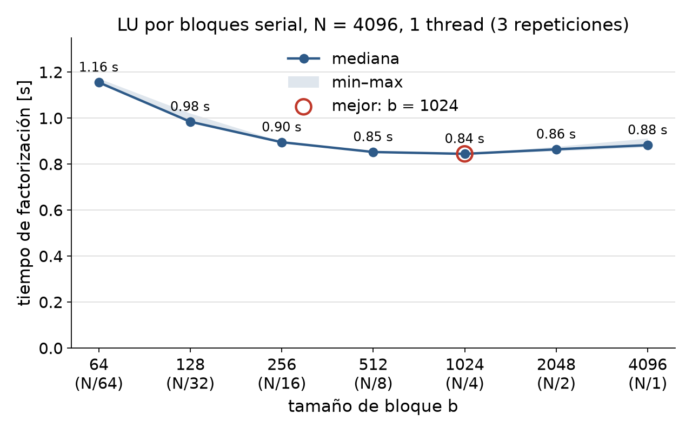
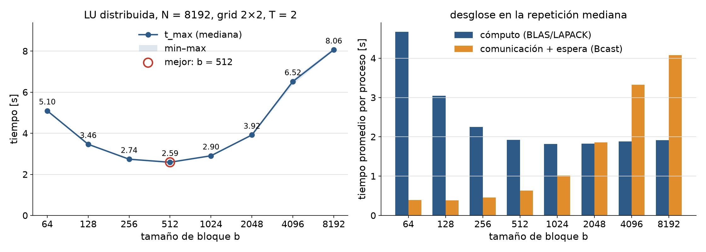
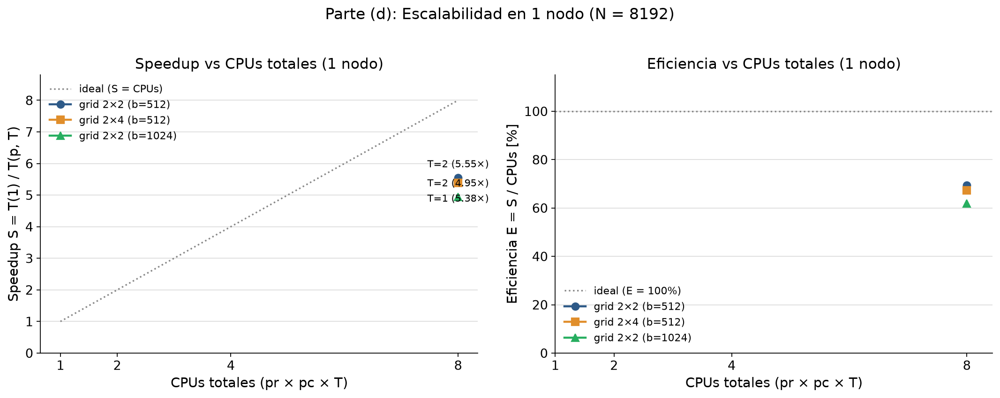
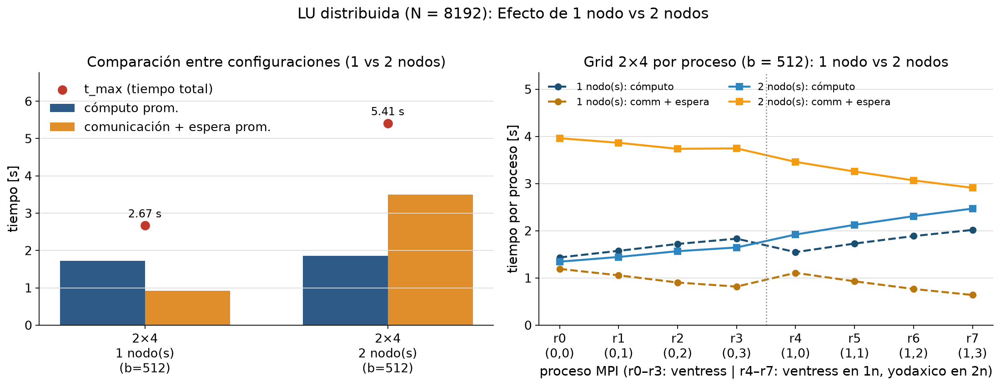
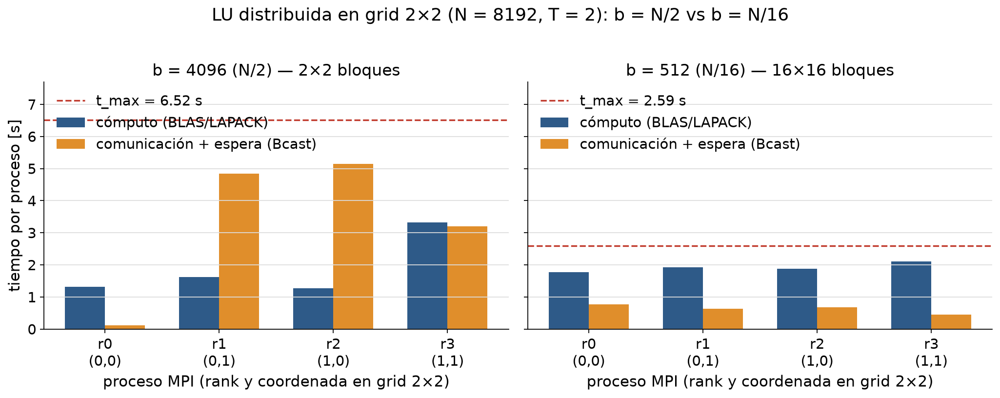

# Objetivo y metodología experimental

Se implementó y evaluó una factorización $A=LU$ por bloques, sin intercambio de filas, sobre un grid bidimensional de procesos MPI. La matriz es densa, de doble precisión, con diagonal $A_{ii}=N$ y entradas restantes $A_{ij}=\sin(10^{-3}ij+0.3i+0.7j)$. Su dominancia diagonal permite trabajar sin pivoteo; además, el código verifica que LAPACK no intercambie filas. Los factores se almacenan sobre el arreglo original: $U$ en el triángulo superior y la parte estrictamente inferior de $L$ bajo la diagonal; la diagonal unitaria de $L$ es implícita.

Se distingue entre el número de procesos MPI $p=p_rp_c$, los threads BLAS por proceso $T$ y el número de CPUs utilizadas $q=p_rp_cT$. El tamaño de bloque es $b$ y el número de bloques por dimensión es $n_b=N/b$; en los experimentos $b$ divide a $N$.

## Entornos utilizados

La parte (a) se ejecutó en el MacBook Pro Apple M5 indicado en los apuntes del grupo. El archivo de metadatos registra arquitectura arm64, macOS 26.6.2, 10 CPUs lógicas, Python 3.11.18, NumPy 2.4.6, SciPy 1.17.1 y OpenBLAS 0.3.34. `threadpoolctl` confirmó un solo thread de BLAS. La RAM no se registró en los metadatos y no se utiliza para interpretar los resultados.

Los experimentos principales se realizaron en el cluster Kraken. Según los apuntes de configuración, `ventress` dispone de dos sockets Intel Xeon E5-2640 v4 y `yodaxico` de dos sockets Intel Xeon Silver 4210R, ambos con 10 núcleos por socket y dos hilos de hardware por núcleo. Se utilizó el entorno Conda del proyecto con mpi4py 4.1.2, NumPy 2.4.6, SciPy 1.17.1 y Open MPI 5.0.11. Estas especificaciones y versiones provienen de los registros del grupo, no de una nueva ejecución de inventario.

Los jobs de un nodo se fijaron en `ventress`. Los de dos nodos utilizaron `ventress` y `yodaxico`. SLURM reservó como máximo 8 CPUs y 4 GB por nodo, con un límite de 15 minutos. Se usó `--threads-per-core=1` para asignar núcleos físicos distintos, `--cpus-per-task=T` y el lanzador `srun --mpi=pmix`. Las variables `OMP_NUM_THREADS`, `OPENBLAS_NUM_THREADS` y `MKL_NUM_THREADS` se fijaron en $T$ antes de importar NumPy. Así, los threads solicitados no excedieron las CPUs reservadas por nodo.

## Medición y tratamiento de los resultados

Cada configuración tiene tres repeticiones. Se reporta la mediana y, cuando corresponde, el mínimo y máximo observados. Estos extremos describen la dispersión de la muestra; no son intervalos de confianza. Los CSV originales se conservaron y las tablas del informe se calcularon directamente a partir de ellos.

En serial se cronometra únicamente la factorización, excluyendo la generación y copia inicial de la matriz. En distribuido cada proceso sincroniza con `Barrier` antes del cronómetro y mide su tiempo de pared $t_{wall,r}$. El tiempo de ejecución es

$$t_{\max}=\max_{0\le r<p}t_{wall,r}.$$

El `Allreduce` que calcula este máximo, la construcción de la matriz, la verificación y la escritura del CSV quedan fuera del intervalo de factorización. Cada proceso acumula con `MPI.Wtime()` dos mediciones:

- $t_c$: factorización diagonal, resoluciones triangulares y actualización mediante producto matricial. La copia del bloque diagonal al buffer también está dentro de esta medición.
- $t_m$: tiempo dentro de los `Bcast`, incluyendo la espera hasta que los otros participantes estén listos.

Por tanto, $t_m$ mide **comunicación y espera**, no transferencia pura. Las asignaciones de buffers, las copias de paneles y el control de Python no están todos incluidos en $t_c+t_m$, aunque sí en $t_{wall}$. Las barras de cómputo/comunicación representan el promedio entre procesos de una misma repetición: la que tiene el $t_{\max}$ mediano. No se suman máximos de procesos diferentes ni se confunde ese promedio con el tiempo crítico.

El rendimiento se expresa como $\mathrm{GFLOP/s}=(2N^3/3)/(10^9t)$, usando el conteo dominante de operaciones de LU.

# (a) Tamaño de bloque en serial — 10 puntos

Se ejecutó `scripts/parte_a.py` con $N=4096$ y un thread BLAS. Se probaron los bloques 4096, 2048, 1024, 512, 256, 128 y 64. Cada repetición recorrió todos los bloques. La tabla procede de `results/parte_a_mac_jose.csv`.

| $b$ | $N/b$ | Mediana [s] | Mín. [s] | Máx. [s] | GFLOP/s |
| --- | --- | --- | --- | --- | --- |
| 4096 | 1 | 0.882 | 0.874 | 0.912 | 51.9 |
| 2048 | 2 | 0.864 | 0.857 | 0.876 | 53.0 |
| 1024 | 4 | 0.845 | 0.841 | 0.845 | 54.2 |
| 512 | 8 | 0.853 | 0.851 | 0.856 | 53.7 |
| 256 | 16 | 0.895 | 0.895 | 0.898 | 51.2 |
| 128 | 32 | 0.984 | 0.980 | 1.021 | 46.5 |
| 64 | 64 | 1.155 | 1.152 | 1.173 | 39.7 |

Se elige **$b=1024$**, con mediana de 0.845 s y 54.2 GFLOP/s. Los bloques 512 y 2048 quedaron aproximadamente a 1% y 2% del mejor tiempo; es un mínimo relativamente plano para esta muestra. En cambio, $b=64$ demoró cerca de 37% más.

El conteo dominante de operaciones no cambia con $b$, pero sí su reparto entre factorización diagonal, resoluciones triangulares y productos matriciales. Bloques pequeños requieren más recorridos y temporales y pueden aprovechar peor BLAS; bloques grandes concentran trabajo en diagonal y paneles. El mínimo intermedio es compatible con este compromiso. No se midieron contadores de caché para aislar sus causas.

En los CSV, los residuos relativos están en el orden de $10^{-16}$. El checksum registrado es consistente entre bloques, pero la evidencia de correctitud numérica es el residuo, no el checksum por sí solo.


```{=latex}
\clearpage
\begin{landscape}
```

{width=240mm height=155mm keepaspectratio=true}

```{=latex}
\end{landscape}
\clearpage
```


# (b) Implementación distribuida — 20 puntos

## Distribución y almacenamiento local

`src/lu_distributed.py` recibe $N,b,p_r,p_c$ y exige $p_rp_c=\mathrm{size}$. El bloque global $A_{IJ}$ pertenece al proceso $(I\bmod p_r,J\bmod p_c)$. Cada proceso construye sus entradas con `matrix_entries` a partir de índices globales; así se utiliza la misma matriz que en serial sin un `Scatter` inicial.

Los bloques de cada proceso se almacenan por índices globales crecientes en un solo arreglo local de tamaño $(n_{lr}b)\times(n_{lc}b)$. En el paso $k$, sean $i_s,j_s$ las cantidades de bloques locales de filas y columnas con índice global menor o igual que $k$. La parte aún no factorizada corresponde a `Aloc[i_s*b:, j_s*b:]`; se actualiza con **una sola multiplicación matricial por proceso y paso**. Es una región rectangular del arreglo local, aunque la vista de NumPy puede conservar un stride de fila mayor que su ancho y no ser contigua en sentido C. Los paneles enviados se copian a buffers contiguos.

La distribución también admite $n_b$ no múltiplo de $p_r$ o $p_c$, mediante tamaños locales distintos. En particular, no se presupone que todos los procesos posean igual cantidad de bloques.

## Colectivas del paso general

Se construyen `row_comm = comm.Split(myrow, mycol)` y `col_comm = comm.Split(mycol, myrow)`. Dentro de `row_comm`, el rank local es `mycol`; dentro de `col_comm`, es `myrow`. En el paso $k$ el dueño del bloque diagonal es $(r,c)=(k\bmod p_r,k\bmod p_c)$.

| Difusión | Comunicador | Raíz local | Tamaño [float64] |
| --- | --- | --- | --- |
| Bloque diagonal en fila $r$ | `row_comm` de esa fila | $c$ | $b^2$ |
| Bloque diagonal en columna $c$ | `col_comm` de esa columna | $r$ | $b^2$ |
| Panel $L$ de cada fila del grid | `row_comm` de cada fila | $c$ | $(n_{lr}-i_s)b^2$ |
| Panel $U$ de cada columna del grid | `col_comm` de cada columna | $r$ | $(n_{lc}-j_s)b^2$ |

Primero, el dueño factoriza $A_{kk}$ y difunde el bloque empaquetado de $L_{kk}$ y $U_{kk}$ en su fila y columna. Solo los integrantes de esos comunicadores participan en estas dos difusiones. Los procesos de la fila $r$ calculan $U_{kj}=L_{kk}^{-1}A_{kj}$; los de la columna $c$ calculan $L_{ik}=A_{ik}U_{kk}^{-1}$, implementado mediante una resolución triangular transpuesta.

Después se difunden los paneles: en cada fila la raíz es el proceso de columna $c$, y en cada columna la raíz es el proceso de fila $r$. Todos participan en estas difusiones de sus respectivos comunicadores, incluso si el panel tiene cero elementos. Finalmente cada proceso con filas y columnas pendientes ejecuta $A_{local}\leftarrow A_{local}-L_{panel}U_{panel}$. La factorización utiliza `Bcast`; `gather` aparece en la verificación y recolección de resultados, fuera del núcleo medido.

Por ejemplo, para $k=2$ y grid $2\times3$, el dueño de $A_{22}$ es $(0,2)$. Este difunde por fila con raíz local 2 y por columna con raíz local 0. El proceso $(1,1)$ recibe $[L_{32};L_{52}]$ desde $(1,2)$ por su fila y $U_{24}$ desde $(0,1)$ por su columna, y actualiza conjuntamente $[A_{34};A_{54}]$ con un producto.

## Verificación y control de recursos

Con `--verify`, los bloques se reúnen en rank 0, se reconstruye la matriz de factores y se ejecuta la versión serial sobre la misma matriz y con el mismo $b$. Se calculan

$$\delta=\frac{\max_{ij}|(LU_{dist}-LU_{serial})_{ij}|}{\max_{ij}|(LU_{serial})_{ij}|},\qquad
\rho=\frac{\|A-LU\|_F}{\|A\|_F}.$$

El programa exige que ambos sean menores que $10^{-8}$. Según los apuntes de verificación del grupo, los 12 casos locales de `scripts/test_distributed.sh` pasaron con $\delta=0$ y residuos aproximadamente entre $1.6\times10^{-16}$ y $2.2\times10^{-16}$.

| Casos del script | Cobertura |
| --- | --- |
| $1\times1$, $N=512,b=64$ | Equivalencia con serial |
| $2\times2$, $N=512,b=64,256,512$ | Bloques pequeños y caso $b=N$ |
| $1\times4$ y $4\times1$, $N=512,b=64$ | Grids con una dimensión unitaria |
| $2\times3$, $N=384,b=32$ | Distribución de 12 bloques por dimensión |
| $2\times3$ y $3\times2$, $N=640,b=64$ | $n_b=10$, no múltiplo de todas las dimensiones |
| $2\times4$, $N=1024,b=128$; $4\times2$, $N=1024,b=64$ | Grids de ocho procesos |
| $2\times2$, $N=1000,b=100$ | Tamaño no potencia de dos |

Los apuntes del cluster también registran verificación correcta en dos nodos, con diferencia relativa $4.4\times10^{-16}$ y residuo $1.5\times10^{-16}$. Por ello no se afirma identidad bit a bit para cualquier hardware: las diferencias de BLAS pueden cambiar el redondeo. Estos resultados históricos se complementaron con una nueva revisión local el 15 de noviembre: se ejecutaron los cinco tests de distribución y los 14 casos de la suite ampliada, todos correctos. Los dos casos adicionales ($2\times3,N=64,b=64$ y $1\times8,N=64,b=32$) ejercitan procesos sin bloques locales y paneles vacíos. En esta revisión las diferencias frente a serial fueron cero y los residuos estuvieron entre $1.21\times10^{-16}$ y $2.17\times10^{-16}$. Se conservaron las salidas y el entorno en `informe/verificacion/`. Estas pruebas pequeñas verifican correctitud; no sustituyen las mediciones de rendimiento del cluster. El `gather` de verificación se reserva para problemas pequeños y se excluye de las mediciones grandes.

Para evitar oversubscription se fija $T$ antes de cargar BLAS y se respeta $pT\leq$ núcleos disponibles en la ejecución local, o la asignación por nodo de SLURM en el cluster. En particular, grid $2\times2$ con $T=2$ utiliza 8 CPUs; grid $4\times4$ con $T=1$ utiliza 16 CPUs distribuidas en dos nodos.

```{=latex}
\clearpage
```

# (c) Tamaño de bloque en el cluster — 10 puntos

Se utilizó $N=8192$, configuración 2, grid $2\times2$, $T=2$, un nodo `ventress` y tres repeticiones por bloque. La fuente es `results/cluster/parte_c.csv`, job 37838. Se incluyen los bloques de (a) y, adicionalmente, $b=8192$ como caso extremo de un único bloque.

| $b$ | $t_{\max}$ [s] | Mín. [s] | Máx. [s] | $\bar t_c$ [s] | $\bar t_m$ [s] | GFLOP/s |
| --- | --- | --- | --- | --- | --- | --- |
| 8192 | 8.062 | 8.036 | 8.162 | 1.911 | 4.082 | 45.5 |
| 4096 | 6.520 | 6.378 | 6.622 | 1.881 | 3.324 | 56.2 |
| 2048 | 3.918 | 3.898 | 3.966 | 1.824 | 1.857 | 93.6 |
| 1024 | 2.905 | 2.900 | 2.940 | 1.820 | 1.020 | 126.2 |
| 512 | 2.589 | 2.587 | 2.625 | 1.924 | 0.630 | 141.6 |
| 256 | 2.738 | 2.721 | 2.767 | 2.250 | 0.460 | 133.8 |
| 128 | 3.464 | 3.458 | 3.489 | 3.047 | 0.388 | 105.8 |
| 64 | 5.096 | 5.084 | 5.113 | 4.672 | 0.391 | 71.9 |

Aquí $\bar t_c$ y $\bar t_m$ son promedios entre los cuatro procesos de la repetición mediana. El mínimo medido es **$b=512$**, con $t_{\max}=2.589$ s y 141.6 GFLOP/s. Por tanto, el $b=1024$ seleccionado en (a) **no sigue siendo el mejor**: tarda 2.905 s, aproximadamente 12% más. $b=256$ está alrededor de 6% sobre el mínimo.

Con $b$ grande hay pocos bloques y la distribución tiene poco margen para equilibrar el trabajo restante. Para $b=N$, un único proceso factoriza toda la matriz y los otros esperan; para $b=N/2$, la actualización final queda concentrada en un proceso. Al bajar $b$, mejora la distribución, pero aumenta el número de pasos y disminuye la eficiencia efectiva de las operaciones locales: entre $b=1024$ y $b=64$, el cómputo promedio aumenta de 1.820 s a 4.672 s.

El cambio de óptimo es consistente con la incorporación de comunicación y desbalance a la ejecución distribuida. También cambian la arquitectura y $N$, de modo que estas mediciones no permiten atribuir toda la diferencia a un solo factor. Se conservan **ambos valores, 1024 y 512**, para las comparaciones de (d) y (e).


```{=latex}
\clearpage
\begin{landscape}
```

{width=240mm height=155mm keepaspectratio=true}

```{=latex}
\end{landscape}
\clearpage
```


# (d) Configuraciones 0 a 3: speedup y eficiencia — 20 puntos

Se usó $N=8192$ en un nodo `ventress`, con $b=512$ y $b=1024$. La configuración 0 varía $T\in\{1,2,4,8\}$ con un proceso; la 1 usa grids $1\times2$ y $2\times1$ con $T\in\{1,2,4\}$; la 2 usa $2\times2$ con $T\in\{1,2\}$; y la 3 compara $2\times4$ con $4\times2$, ambos con $T=1$. Los datos proceden de `results/cluster/config0.csv` a `config3.csv`.

## Referencia y métricas

Se define $T_1(b)$ como la mediana del código distribuido con un proceso y un thread en el mismo nodo, con igual $N$ y bloque. Se obtienen $T_1(512)=11.208$ s y $T_1(1024)=10.831$ s. El uso de una referencia por bloque mide el escalamiento de cada variante, en lugar de mezclar el efecto del tamaño de bloque con el paralelismo.

$$S(p_r,p_c,T;b)=\frac{T_1(b)}{t_{\max}(p_r,p_c,T;b)},\qquad
E=\frac{S}{p_rp_cT}.$$

Como contraste, si se utiliza una única referencia para comparar ambos bloques, $T_1^*=\min_bT_1(b)=10.831$ s, la configuración ganadora con $b=512$ obtiene $S=4.17$ y $E=52.1\%$. La elección de la configuración de menor tiempo no cambia.

No se utiliza el tiempo de (a), porque cambia tanto la arquitectura como $N$. En grid $1\times1$ las colectivas no transfieren entre procesos y su tiempo registrado es cercano a 0.0004 s. Como contraste, las mediciones seriales del cluster con un thread fueron 11.062 s para $b=512$ y 10.507 s para $b=1024$, diferencias pequeñas respecto a la referencia distribuida.

## Resultados con $b=512$

| Config. | Grid | $T$ | CPUs | Tiempo [s] | $S$ | $E$ |
| --- | --- | --- | --- | --- | --- | --- |
| 0 | 1×1 | 1 | 1 | 11.208 | 1.00 | 100.0% |
| 0 | 1×1 | 2 | 2 | 6.677 | 1.68 | 83.9% |
| 0 | 1×1 | 4 | 4 | 4.226 | 2.65 | 66.3% |
| 0 | 1×1 | 8 | 8 | 3.058 | 3.66 | 45.8% |
| 1 | 1×2 | 1 | 2 | 6.578 | 1.70 | 85.2% |
| 1 | 1×2 | 2 | 4 | 3.942 | 2.84 | 71.1% |
| 1 | 1×2 | 4 | 8 | 2.620 | 4.28 | 53.5% |
| 1 | 2×1 | 1 | 2 | 6.832 | 1.64 | 82.0% |
| 1 | 2×1 | 2 | 4 | 4.308 | 2.60 | 65.0% |
| 1 | 2×1 | 4 | 8 | 2.983 | 3.76 | 47.0% |
| 2 | 2×2 | 1 | 4 | 4.015 | 2.79 | 69.8% |
| 2 | 2×2 | 2 | 8 | 2.597 | 4.32 | 53.9% |
| 3 | 2×4 | 1 | 8 | 2.670 | 4.20 | 52.5% |
| 3 | 4×2 | 1 | 8 | 2.754 | 4.07 | 50.9% |

## Resultados con $b=1024$

| Config. | Grid | $T$ | CPUs | Tiempo [s] | $S$ | $E$ |
| --- | --- | --- | --- | --- | --- | --- |
| 0 | 1×1 | 1 | 1 | 10.831 | 1.00 | 100.0% |
| 0 | 1×1 | 2 | 2 | 6.511 | 1.66 | 83.2% |
| 0 | 1×1 | 4 | 4 | 4.088 | 2.65 | 66.2% |
| 0 | 1×1 | 8 | 8 | 2.971 | 3.65 | 45.6% |
| 1 | 1×2 | 1 | 2 | 6.928 | 1.56 | 78.2% |
| 1 | 1×2 | 2 | 4 | 4.160 | 2.60 | 65.1% |
| 1 | 1×2 | 4 | 8 | 2.754 | 3.93 | 49.2% |
| 1 | 2×1 | 1 | 2 | 7.199 | 1.50 | 75.2% |
| 1 | 2×1 | 2 | 4 | 4.422 | 2.45 | 61.2% |
| 1 | 2×1 | 4 | 8 | 3.079 | 3.52 | 44.0% |
| 2 | 2×2 | 1 | 4 | 4.555 | 2.38 | 59.5% |
| 2 | 2×2 | 2 | 8 | 2.912 | 3.72 | 46.5% |
| 3 | 2×4 | 1 | 8 | 3.167 | 3.42 | 42.8% |
| 3 | 4×2 | 1 | 8 | 3.468 | 3.12 | 39.0% |

Cada tiempo es mediana de tres repeticiones. Los rangos mínimo–máximo se incluyen en el anexo. La eficiencia se expresa en porcentaje y considera todas las CPUs, incluidos los threads por proceso.

La configuración con menor mediana es **configuración 2, grid $2\times2$, $T=2$, $b=512$**, con 2.597 s, speedup 4.32 y eficiencia 53.9%. Le sigue muy cerca $1\times2$, $T=4$, con 2.620 s: la diferencia es menor que 1%, por lo que no se presenta como una superioridad concluyente ante cualquier variación de carga del cluster.

Para ocho CPUs y $b=512$, threads puros ($1\times1,T=8$) demoran 3.058 s; MPI puro ($2\times4,T=1$), 2.670 s; y el híbrido ($2\times2,T=2$), 2.597 s. El híbrido combina menos participantes MPI con paralelismo BLAS local. En las repeticiones medianas, MPI puro tiene cómputo promedio de 1.726 s y comunicación/espera de 0.917 s, mientras el híbrido presenta 1.932 s y 0.630 s: menor comunicación/espera compensa un cómputo local algo mayor.

El grid sí afecta los resultados. Para $b=512,T=4$, $1\times2$ tarda 2.620 s frente a 2.983 s de $2\times1$. Con ocho procesos, $2\times4$ demora 2.670 s frente a 2.754 s de $4\times2$. Para $b=1024$ la última diferencia aumenta: 3.167 s frente a 3.468 s. En los datos se favorece sistemáticamente la orientación con más columnas.

El código no es simétrico ante transponer el grid: el panel $L$ se resuelve mediante una vista transpuesta y las difusiones del bloque diagonal se realizan primero por fila y luego por columna. Junto con el acceso a memoria y las formas de los productos locales, esto ofrece explicaciones posibles para la asimetría; sin perfilar cada operación por separado no se asigna una contribución causal exacta a cada una. Por último, $b=1024$ es algo mejor en $1\times1$, mientras $b=512$ resulta más rápido en todas las variantes medidas con múltiples procesos MPI.


```{=latex}
\clearpage
\begin{landscape}
```

{width=240mm height=155mm keepaspectratio=true}

```{=latex}
\end{landscape}
\clearpage
```


# (e) Configuraciones 4 y 5: dos nodos — 15 puntos

Se mantuvo $N=8192$ y se probaron $b=512,1024$. La configuración 4 utiliza grid $2\times4$, $T=1$ y cuatro procesos por nodo; tiene las mismas ocho CPUs que la configuración 3 con grid $2\times4$ en un nodo. La configuración 5 utiliza grid $4\times4$, $T=1$, con ocho procesos por nodo y 16 CPUs totales. Se utilizan los datos definitivos de `config3.csv`, `config4.csv` y `config5.csv`, excluyendo las ejecuciones preliminares de `test_2nodos.csv`.

| $b$ | Config. | Grid | Nodos | CPUs | Tiempo [s] | $\bar t_c$ [s] | $\bar t_m$ [s] |
| --- | --- | --- | --- | --- | --- | --- | --- |
| 512 | 3 | 2×4 | 1 | 8 | 2.670 | 1.726 | 0.917 |
| 512 | 4 | 2×4 | 2 | 8 | 5.668 | 1.858 | 3.754 |
| 512 | 5 | 4×4 | 2 | 16 | 4.521 | 0.998 | 3.426 |
| 1024 | 3 | 2×4 | 1 | 8 | 3.167 | 1.606 | 1.480 |
| 1024 | 4 | 2×4 | 2 | 8 | 6.241 | 1.787 | 4.253 |
| 1024 | 5 | 4×4 | 2 | 16 | 5.526 | 0.956 | 4.137 |

Con $b=512$, pasar de configuración 3 a 4 aumenta el tiempo de 2.670 s a 5.668 s, un factor 2.12. El cómputo promedio pasa de 1.726 s a 1.858 s, mientras comunicación y espera crecen de 0.917 s a 3.754 s, aproximadamente 4.1 veces. Con $b=1024$, el tiempo total aumenta de 3.167 s a 6.241 s. Así, distribuir las mismas ocho CPUs en dos nodos perjudica este problema.

En configuración 4, ranks 0–3 están en `ventress` y 4–7 en `yodaxico`: las filas del grid se comunican dentro del nodo y las columnas cruzan la red. La latencia $\alpha$ penaliza cada mensaje y $\beta=8/B$ es el costo por palabra float64 para ancho de banda $B$ bytes/s. Frente a memoria compartida, mayor latencia y menor ancho de banda inter-nodo penalizan respectivamente muchas colectivas y paneles grandes. El aumento de $t_m$ es consistente con esos efectos, sin permitir estimarlos por separado. Se distingue además la espera por diferencias de ejecución local.

## Desglose de las ejecuciones de dos nodos

| $b$ | Config. | Nodo | Ranks | $\bar t_c$ [s] | $\bar t_m$ [s] |
| --- | --- | --- | --- | --- | --- |
| 512 | 4 | ventress | 0–3 | 1.516 | 4.069 |
| 512 | 4 | yodaxico | 4–7 | 2.200 | 3.438 |
| 512 | 5 | ventress | 0–7 | 0.786 | 3.597 |
| 512 | 5 | yodaxico | 8–15 | 1.210 | 3.256 |
| 1024 | 4 | ventress | 0–3 | 1.366 | 4.546 |
| 1024 | 4 | yodaxico | 4–7 | 2.207 | 3.960 |
| 1024 | 5 | ventress | 0–7 | 0.664 | 4.225 |
| 1024 | 5 | yodaxico | 8–15 | 1.247 | 4.050 |

En configuración 4 con $b=512$, `yodaxico` registra 2.200 s de cómputo promedio frente a 1.516 s de `ventress`. A su vez, `ventress` acumula más espera/comunicación: 4.069 s frente a 3.438 s. Esto es compatible con procesos rápidos esperando a procesos más lentos. La comparación por host también incluye diferencias de trabajo entre filas del grid. Una prueba serial previa del grupo ($N=2048,b=256,T=1$) registró 0.224 s en `ventress` y 0.323 s en `yodaxico`, respaldando una posible contribución del hardware. Sin microbenchmarks, no se separan exactamente red, desbalance y espera.

La configuración 5 reduce el cómputo promedio a 0.998 s para $b=512$ y baja el tiempo total a 4.521 s. Es 1.25 veces más rápida que configuración 4 con el doble de CPUs, lo que equivale a una eficiencia incremental de aproximadamente 62.7%. Sin embargo, sigue siendo más lenta que las ocho CPUs de un solo nodo. Comunicación y espera representan aproximadamente 77% de $\bar t_c+\bar t_m$ en configuración 5 con $b=512$; para $b=1024$ alcanzan 81%. El aumento de procesos no compensa los costos de coordinación para este tamaño de matriz.


```{=latex}
\clearpage
\begin{landscape}
```

{width=240mm height=155mm keepaspectratio=true}

```{=latex}
\end{landscape}
\clearpage
```


# (f) Efecto del bloque sobre cada proceso — 15 puntos

Se comparan $b=N/2=4096$ y $b=N/16=512$ con $N=8192$, grid $2\times2$, $T=2$ y un nodo `ventress`. Se reutilizan las mediciones de `parte_c.csv`: el inciso exige el grid y los dos bloques, sin fijar un valor distinto de $T$. Para cada bloque se selecciona la ejecución de tiempo mediano y se presentan los cuatro procesos de esa misma ejecución.

| $b$ | Rank | Coordenadas | $t_c$ [s] | $t_m$ [s] | $t_{wall}$ [s] | $t_{\max}$ [s] |
| --- | --- | --- | --- | --- | --- | --- |
| 4096 | 0 | (0,0) | 1.313 | 0.114 | 1.427 | 6.520 |
| 4096 | 1 | (0,1) | 1.623 | 4.843 | 6.519 | 6.520 |
| 4096 | 2 | (1,0) | 1.273 | 5.138 | 6.467 | 6.520 |
| 4096 | 3 | (1,1) | 3.316 | 3.202 | 6.520 | 6.520 |
| 512 | 0 | (0,0) | 1.774 | 0.767 | 2.569 | 2.589 |
| 512 | 1 | (0,1) | 1.927 | 0.629 | 2.589 | 2.589 |
| 512 | 2 | (1,0) | 1.880 | 0.675 | 2.587 | 2.589 |
| 512 | 3 | (1,1) | 2.114 | 0.449 | 2.589 | 2.589 |

Con $b=4096$ hay solo cuatro bloques globales, uno por proceso. En el primer paso, rank 0 factoriza $A_{00}$; ranks 1 y 2 calculan $U_{01}$ y $L_{10}$; rank 3 actualiza $A_{11}$ y luego factoriza ese bloque en el siguiente paso. Esto concentra trabajo y dependencias en rank 3, cuyo cómputo es 3.316 s, frente a 1.273–1.623 s de los otros procesos.

Ranks 1 y 2 acumulan 4.843 s y 5.138 s en `Bcast`: gran parte corresponde a espera por el progreso de otros procesos, no a mayor cantidad de datos propios que transferir. Rank 0 termina su intervalo local en 1.427 s porque ya no tiene actualizaciones pendientes; no existe una barrera final dentro del cronómetro. El tiempo del job sigue siendo 6.520 s, máximo de los procesos.

Con $b=512$ hay 256 bloques globales y 64 bloques locales por proceso. Los 16 pasos reparten mejor las actualizaciones: el cómputo varía entre 1.774 s y 2.114 s y la comunicación/espera entre 0.449 s y 0.767 s. Aunque hay más llamadas colectivas, disminuye el desbalance y el tiempo global baja a 2.589 s, aproximadamente **2.52 veces más rápido**. Esta comparación muestra por qué contar solo mensajes no basta para elegir $b$.


```{=latex}
\clearpage
\begin{landscape}
```

{width=240mm height=155mm keepaspectratio=true}

```{=latex}
\end{landscape}
\clearpage
```


# (g) Modelo de costo — 10 puntos

## Parámetros y costo por paso

Sea $\alpha$ la latencia efectiva por etapa de comunicación [s], $\beta$ el tiempo por palabra float64 [s/palabra] y $\gamma$ el tiempo por flop de un proceso con $T$ threads [s/flop]. Se supone primero hardware homogéneo, bloques repartidos aproximadamente por igual y un mismo costo efectivo para las primitivas locales. Esta última es una simplificación: GETRF, TRSM y GEMM tienen eficiencias distintas y dependen del tamaño.

Para representar una difusión en árbol se define $h(1)=0$ y $h(P)=\lceil\log_2P\rceil$ para $P>1$, con $C_{Bcast}(P,w)\approx h(P)(\alpha+\beta w)$. Es un modelo orientativo; MPI puede elegir otros algoritmos según el mensaje y el comunicador. Escribimos $h_r=h(p_r)$ y $h_c=h(p_c)$.

En el paso $k$ queda una submatriz de dimensión $m_k=N-(k+1)b$. Un modelo de etapas para su camino crítico es

$$C_k\approx\gamma\left[\frac23b^3+b^2m_k\left(\frac1{p_r}+\frac1{p_c}\right)+\frac{2bm_k^2}{p_rp_c}\right].$$

El primer término corresponde a la factorización de un único bloque diagonal. Los dos términos de paneles describen el trabajo sobre una fila y una columna del grid. Se suman como aproximación conservadora: el dueño de la diagonal participa en ambos, aunque otros procesos pueden resolver paneles simultáneamente. El último término representa la actualización distribuida. El tiempo real depende del solapamiento entre procesos, las llegadas a las colectivas y el desequilibrio discreto de bloques.

Las difusiones diagonales y de paneles aportan aproximadamente

$$M_k\approx 2\alpha(h_c+h_r)+\beta\left[b^2(h_c+h_r)+bm_k\left(\frac{h_c}{p_r}+\frac{h_r}{p_c}\right)\right].$$

Aquí el panel $L$, de tamaño aproximado $bm_k/p_r$, se difunde en filas de $p_c$ procesos; el panel $U$, de tamaño $bm_k/p_c$, en columnas de $p_r$ procesos. Las distintas filas pueden difundir a la vez: no se multiplica su costo de camino crítico por el número de filas. En el último paso los paneles están vacíos; conservar sus términos de latencia es una simplificación de orden menor, y en comunicadores de un proceso el costo de red se anula por $h(1)=0$.

## Suma sobre los pasos

Para $n_b=N/b$,

$$\sum_km_k=\frac{N^2/b-N}{2},\qquad
\sum_km_k^2=\frac{N^3}{3b}-\frac{N^2}{2}+\frac{Nb}{6}.$$

Al sumar se obtiene el modelo de cómputo

$$C\approx\gamma\left[\frac23Nb^2+\frac{N^2b-Nb^2}{2}\left(\frac1{p_r}+\frac1{p_c}\right)+\frac{\frac23N^3-N^2b+\frac13Nb^2}{p_rp_c}\right],$$

y el de comunicación

$$M\approx 2\frac{N}{b}\alpha(h_c+h_r)+\beta\left[Nb(h_c+h_r)+\frac{N^2-Nb}{2}\left(\frac{h_c}{p_r}+\frac{h_r}{p_c}\right)\right].$$

Por tanto, $t_{modelo}\approx C+M$, al que en una ejecución real se agregan efectos de desbalance, memoria y administración no capturados por el reparto continuo. Las fórmulas preservan los términos de borde: para $p_r=p_c=1$ se obtiene $M=0$ y $C=\gamma(2N^3/3)$, consistente con que el conteo dominante serial no depende del bloqueo. Para $b=N$ se anulan paneles y actualización.

Para identificar la dependencia en $b$ sin perder términos del mismo orden, se pueden reagrupar las expresiones anteriores. Definiendo

$$a_p=\frac1{2p_r}+\frac1{2p_c}-\frac1{p_rp_c},\qquad
 d_p=\frac23-\frac1{2p_r}-\frac1{2p_c}+\frac1{3p_rp_c},$$

$$H=h_c+h_r,\qquad K=\frac{h_c}{p_r}+\frac{h_r}{p_c},$$

resulta

$$C\approx\gamma\left[\frac{2N^3}{3p_rp_c}+a_pN^2b+d_pNb^2\right],$$
$$M\approx\frac{2NH\alpha}{b}+\beta\left[\frac{N^2K}{2}+Nb\left(H-\frac K2\right)\right].$$

Los coeficientes $a_p,d_p$ son no negativos para grids con dimensiones enteras positivas y se anulan en $1\times1$. Esta forma evita sumar correcciones positivas y omitir otras del mismo orden. En un grid $2\times2$, $a_p=d_p=1/4$ y, con el árbol adoptado, $H=2,K=1$.

Si $\gamma$ se mantiene constante y se trata $b$ como continuo, un óptimo interior satisface

$$\left[\gamma(a_pN+2d_pb)+\beta\left(H-\frac K2\right)\right]b^2=2H\alpha.$$

La ecuación expresa el equilibrio entre el costo creciente de diagonal/paneles y la latencia decreciente con $b$. Las expresiones reagrupadas se contrastaron con las sumas por paso en 49 combinaciones de parámetros, mediante aritmética racional exacta; el registro está en `informe/verificacion/modelo.json`. Luego se deben considerar solo bloques admisibles que dividan a $N$. En las mediciones también cambia la eficiencia BLAS con $b$, por lo que la ecuación sin calibración no determina por sí sola el óptimo observado.

Cuando hay pocos bloques por proceso, el reparto continuo $m_k/p_r$ y $m_k/p_c$ es insuficiente. Una aproximación más conservadora utiliza $b\lceil(m_k/b)/p_r\rceil$ y $b\lceil(m_k/b)/p_c\rceil$ para las dimensiones locales máximas. Esta cuantización explica la pérdida de paralelismo observada en (f).

## Óptimo de bloque y cuellos de botella

Al disminuir $b$, crece el número de pasos y el término de latencia proporcional a $N/b$. Además, el costo efectivo $\gamma$ puede aumentar porque los productos de dimensión interna pequeña aprovechan peor BLAS y la memoria. En (c), el aumento de cómputo de 1.820 s con $b=1024$ a 4.672 s con $b=64$ muestra que el costo por flop no es constante en la práctica. El tiempo de comunicación/espera de unos 0.39 s con bloques pequeños no permite, por sí solo, estimar una latencia pura.

Al aumentar $b$, crecen el trabajo diagonal serializado ($Nb^2$), el trabajo de paneles con paralelismo restringido ($N^2b$) y el volumen diagonal ($Nb$). También disminuye el número de bloques disponibles para equilibrar el trabajo. El mínimo medido en $b=512$ es compatible con un equilibrio entre estas tendencias; el modelo sin parámetros calibrados no predice numéricamente que el mínimo deba ser exactamente 512.

Los cuellos de botella observados dependen del régimen:

- **Un nodo y bloque intermedio:** en configuración 2, $b=512,T=2$, el cómputo promedio es 1.932 s y comunicación/espera 0.630 s, aproximadamente 75% y 25% de su suma. Predomina el cómputo local, aunque reducir comunicación y desbalance sigue siendo relevante.
- **Bloque grande:** con $b=4096$ en (f), pocos procesos sostienen el camino crítico y otros esperan en las colectivas. La restricción principal es el paralelismo insuficiente y la dependencia entre etapas, no una transferencia de red demostrada como dominante.
- **Dos nodos:** en configuración 4 con $b=512$, comunicación/espera promedio alcanza 3.754 s frente a 1.858 s de cómputo. La coordinación entre nodos, junto con las diferencias de ejecución local, domina el desglose medido. Con 16 CPUs la configuración 5 reduce el cómputo, pero la comunicación/espera sigue en 3.426 s.

Para modelar los dos nodos con mayor fidelidad se necesitarían parámetros distintos de comunicación intra/inter nodo, costos locales por host y por primitiva, y medidas separadas de transferencia y espera. Los CSV disponibles permiten identificar el régimen observado, pero no ajustar de manera única $\alpha,\beta,\gamma$.

# Conclusiones

Para la ejecución serial personal se seleccionó $b=1024$; para el cluster distribuido, $b=512$. La menor mediana de las configuraciones comparadas fue 2.597 s con grid $2\times2$, dos threads por proceso y un nodo, muy cercana a 2.620 s de $1\times2$ con cuatro threads. Los datos favorecen bloques que permitan repartir suficientes actualizaciones y una combinación moderada de procesos e hilos. Para $N=8192$, repartir el trabajo en dos nodos no mejoró los tiempos de un nodo. La interpretación depende de distinguir transferencia, espera y cómputo, y de declarar la configuración exacta de cada medición.

# Declaración de uso de IA

Se utilizó ChatGPT/Codex para redactar este informe a partir del código, apuntes y resultados existentes; contrastar tablas con los CSV; revisar el modelo de costo; mejorar scripts de verificación y gráficos; ejecutar comprobaciones locales de correctitud; y preparar los archivos de compilación y entrega. Los tiempos de rendimiento presentados provienen de las ejecuciones registradas por el grupo y no fueron reemplazados por las pruebas locales de auditoría. Las nuevas verificaciones se identifican por separado y sus resultados se conservaron. Esta declaración describe la asistencia utilizada para preparar y revisar este documento.

# Anexo: trazabilidad y reproducción

## Fuentes del informe

El enunciado de referencia es `docs/tarea03.pdf`. Los resultados de (a) provienen de `results/parte_a_mac_jose.csv` y su archivo de metadatos. Los de (c) y (f) provienen de `results/cluster/parte_c.csv`. Para (d) se usan `config0.csv` a `config3.csv`; para (e), `config3.csv` (solo grid $2\times4$), `config4.csv` y `config5.csv`. Las mediciones `results/parte_a_kraken_T1.csv` permiten contrastar la referencia serial del cluster. Los apuntes técnicos están en `informe/apuntes/`; las afirmaciones sobre verificaciones históricas se atribuyen a esos registros. Las verificaciones locales nuevas están documentadas en `informe/verificacion/`; `scripts/audit_results.py` comprueba las 40 grupos de medición distribuidos, 480 filas por proceso, 21 mediciones seriales y las ocho tablas numéricas del informe sin modificar los CSV.

Los jobs de las configuraciones definitivas tienen identificadores entre 39644 y 39683, registrados por fila en los CSV. Cada fila representa un proceso y una repetición. La selección de la repetición mediana conserva juntos los procesos del mismo job y repetición.

## Dispersión de las configuraciones (d) y (e)

Cada fila corresponde a tres repeticiones. El cuerpo del informe presenta su mediana; esta tabla agrega los extremos observados.

| $b$ | Grid | $T$ | Mín. [s] | Máx. [s] |
| --- | --- | --- | --- | --- |
| 512 | 1×1 | 1 | 11.192 | 11.326 |
| 512 | 1×1 | 2 | 6.602 | 6.748 |
| 512 | 1×1 | 4 | 4.197 | 4.233 |
| 512 | 1×1 | 8 | 3.057 | 3.113 |
| 512 | 1×2 | 1 | 6.522 | 6.592 |
| 512 | 1×2 | 2 | 3.927 | 4.088 |
| 512 | 1×2 | 4 | 2.606 | 2.648 |
| 512 | 2×1 | 1 | 6.812 | 6.932 |
| 512 | 2×1 | 2 | 4.293 | 4.414 |
| 512 | 2×1 | 4 | 2.965 | 3.005 |
| 512 | 2×2 | 1 | 4.004 | 4.140 |
| 512 | 2×2 | 2 | 2.592 | 2.617 |
| 512 | 2×4 | 1 | 2.668 | 2.736 |
| 512 | 4×2 | 1 | 2.738 | 2.808 |
| 1024 | 1×1 | 1 | 10.805 | 10.943 |
| 1024 | 1×1 | 2 | 6.422 | 6.617 |
| 1024 | 1×1 | 4 | 4.054 | 4.286 |
| 1024 | 1×1 | 8 | 2.945 | 2.995 |
| 1024 | 1×2 | 1 | 6.844 | 7.077 |
| 1024 | 1×2 | 2 | 4.124 | 4.234 |
| 1024 | 1×2 | 4 | 2.746 | 2.823 |
| 1024 | 2×1 | 1 | 7.093 | 7.247 |
| 1024 | 2×1 | 2 | 4.413 | 4.521 |
| 1024 | 2×1 | 4 | 3.057 | 3.116 |
| 1024 | 2×2 | 1 | 4.534 | 4.596 |
| 1024 | 2×2 | 2 | 2.899 | 2.935 |
| 1024 | 2×4 | 1 | 3.142 | 3.235 |
| 1024 | 4×2 | 1 | 3.463 | 3.519 |
| 512 | 2×4 (2 nodos) | 1 | 5.631 | 5.726 |
| 512 | 4×4 (2 nodos) | 1 | 4.504 | 4.531 |
| 1024 | 2×4 (2 nodos) | 1 | 6.216 | 6.278 |
| 1024 | 4×4 (2 nodos) | 1 | 5.507 | 5.526 |

## Comandos de reproducción

Desde la raíz del repositorio, el entorno y las verificaciones pueden prepararse con:

```{=latex}
\begin{samepage}
```

```bash
conda env create -f environment.yml
conda activate tarea3
python tests/test_layout.py
bash scripts/test_distributed.sh
python scripts/audit_results.py
```

```{=latex}
\end{samepage}
```

Para regenerar las figuras a partir de los CSV existentes:

```{=latex}
\begin{samepage}
```

```bash
python scripts/plot_parte_a.py --tag mac_jose
python scripts/plot_parte_c.py
python scripts/plot_parte_d.py
python scripts/plot_parte_e.py
python scripts/plot_parte_f.py
```

```{=latex}
\end{samepage}
```

Las figuras (c)–(f) muestran comunicación incluyendo espera. La figura (f) explicita también los threads BLAS por proceso. Los scripts SLURM y la descripción del lanzamiento están en `slurm/`. No es necesario repetir jobs para compilar el documento.

Con Pandoc y Tectonic disponibles, desde la raíz:

```{=latex}
\begin{samepage}
```

```bash
bash scripts/build_informe.sh
bash scripts/make_zip.sh
```

```{=latex}
\end{samepage}
```

El primer comando genera `informe/informe.tex` e `informe/informe.pdf`; el segundo construye el ZIP con los scripts SLURM, código, pruebas, resultados, fuentes del informe y el PDF, excluyendo auxiliares y ZIPs anidados. Para Overleaf se incluye un paquete de fuentes separado con el archivo LaTeX y sus figuras.
